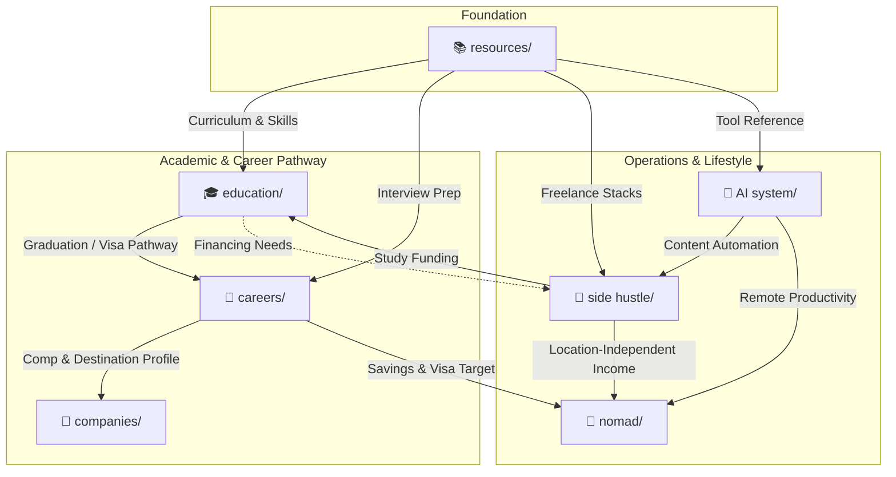

# 🧭 Global Career & Study Planning Workspace: Master Index & Architecture

<!--
title: Global Career, Academic, & Personal AI Automation OS Planning Workspace
description: Comprehensive directory and architectural overview of a multi-stage career acceleration pipeline spanning learning, graduate admissions, global career benchmarking, employer profiling, freelancing, digital nomad lifestyle systems, and self-hosted AI automation OS.
-->

Welcome to the unified planning, study, and execution workspace. This repository contains structured study guides, academic evaluations, freelance blueprints, digital nomad roadmaps, and self-hosted automation systems curated specifically for **Artificial Intelligence (AI), Data Science (DS), Quantitative Finance (Quant)**, and **Systems Engineering** tracks.

---

## 🗺️ Workspace Unified Vision & Execution Roadmap

This workspace represents a sequential self-development and career-acceleration pipeline. Instead of isolated folders, each component acts as a key step in building a global, high-value technical career. 

The core academic and career pipeline progresses as follows:

```
 [Step 01: resources/] ──► [Step 02: education/] ──► [Step 03: careers/] ──► [Step 04: companies/]
    Acquire Skills           Secure Admissions          Select Country          Target Employer
```

In parallel, three operational frameworks support this path:
- **Financial Support & Funding**: [side hustle/](./side%20hustle/) provides freelance templates and digital product roadmaps to generate transitional income and reduce education loan dependency.
- **Automation & Efficiency Engine**: [AI system/](./AI%20system/) establishes a Personal AI Operating System (PAIOS) to automate content creation and handle remote workspace tasks.
- **Lifestyle & Execution Model**: [nomad/](./nomad/) delivers the operational rules (banking, visa, tax) to run this pipeline globally and location-independently.

---

## 🏗️ Folder-by-Folder Structural Analysis

Below is an overview of the purpose, core contents, dependencies, and outputs of each directory in the workspace.

### 1. 📚 [resources/](./resources/) — Study Tracks & Resource Planner
*   **Purpose:** Houses the foundational curricula, study guides, and tool indexes required to master machine learning, quantitative finance, and systems engineering.
*   **Key Contents:**
    *   [career_roadmap_checklist_differentiated.md](./resources/career_roadmap_checklist_differentiated.md): Specific, track-by-track learning checklists (AI & DS, Quant, Hybrid).
    *   [roadmap_differentiated_tracks.md](./resources/roadmap_differentiated_tracks.md): Priority list of 200+ technical topics.
    *   [tools-master-list.md](./resources/tools-master-list.md): Detailed catalog of 109 developer tools and libraries by category.
    *   [free_resources_roadmap.md](./resources/free_resources_roadmap.md): Verified free learning books, courses, and platforms.
*   **Dependencies:** None. This serves as the initial skill-acquisition block of the workspace.
*   **Outputs:** Technical competency and a project portfolio. These directly feed the academic profiles required for [education/](./education/) and the freelance offerings in [side hustle/](./side%20hustle/).

### 2. 🎓 [education/](./education/) — Graduate Master's Admissions & Financing Guide
*   **Purpose:** A comprehensive, 10-stage preparation and timeline guide for applying to top-tier international Master's programs (Fall 2027 intake) in AI, DS, and Quant Finance.
*   **Key Contents:**
    *   [Comprehensive_Global_Education_Guide_2027.md](./education/Comprehensive_Global_Education_Guide_2027.md): Directory of 50 university profiles, curricula, and admissions rates.
    *   [study_abroad_gap_analysis_v2.md](./education/study_abroad_gap_analysis_v2.md): SOP structures, referee briefing plans, and Canada's latest 2026 PGWP/Express Entry rules.
    *   [india_education_loan_abroad_guide.md](./education/india_education_loan_abroad_guide.md): Detailed comparison of education loans (rates, tax benefits, secured vs. unsecured).
*   **Dependencies:** Relies on the technical skills, books, and exam preparations outlined in [resources/](./resources/).
*   **Outputs:** Standardized exam milestones (GRE/IELTS), credential verification (Germany APS, Canada WES), and funding packages. This feeds directly into post-study work pathways in [careers/](./careers/).

### 3. 💼 [careers/](./careers/) — Global Career Strategy & Destination Comparison
*   **Purpose:** Synthesizes and benchmarks salary structures, tax calculators, cost-of-living adjustments, WLB, and visa pathways across 12 global tech hubs to optimize wealth accumulation.
*   **Key Contents:**
    *   [global_careers_comparison.md](./careers/global_careers_comparison.md): Salaries, taxes, and visa accessibility across 12 countries.
    *   [swiss_quant_vs_ai_ds_careers.md](./careers/swiss_quant_vs_ai_ds_careers.md): Dedicated comparison of Switzerland's Quant vs. AI/DS career tracks.
    *   [swiss_ai_ds_vs_alternatives.md](./careers/swiss_ai_ds_vs_alternatives.md): Detailed benchmarking of Switzerland against 7 global rivals.
    *   [top4_qol_inr_comparison.md](./careers/top4_qol_inr_comparison.md): Net savings and Quality of Life (QoL) scorecard converted to Indian Rupees (INR).
*   **Dependencies:** Depends on [education/](./education/) for student-to-worker immigration paths, and [resources/](./resources/) for technical interview readiness.
*   **Outputs:** Target country selection, long-term PR strategy, and local optimization choices (e.g., the "Zug Commuter Loophole"). It links directly to [companies/](./companies/) for employer targeting and [nomad/](./nomad/) for tax residency comparisons.

### 4. 🏢 [companies/](./companies/) — Swiss Tech & Quant Profiles
*   **Purpose:** A deep-dive employer index profiling key software, quantitative finance, and biotech employers in Switzerland (such as Google, Systematica, Microsoft, UBS, Roche).
*   **Key Contents:**
    *   [swiss_quant_ai_companies_profiles.md](./companies/swiss_quant_ai_companies_profiles.md): Detailed descriptions of company hiring practices, compensation structures, and work hours.
    *   [swiss_quant_ai_companies_table.md](./companies/swiss_quant_ai_companies_table.md): Tabular overview of Swiss companies, base salaries, and trade-offs.
*   **Dependencies:** Directly relies on the Swiss career track definitions and market research in [careers/](./careers/).
*   **Outputs:** Tailored preparation paths for specific companies, local networking targets, and optimized application sequences.

### 5. 🚀 [side hustle/](./side%20hustle/) — Side Hustle & Freelance Launch Blueprint
*   **Purpose:** A week-by-week guide to establishing a freelance business earning ₹20K–₹50K/month and building recurring passive income through digital templates, courses, and print-on-demand.
*   **Key Contents:**
    *   [comprehensive-side-hustle-master-guide.md](./side%20hustle/comprehensive-side-hustle-master-guide.md): Blueprint mapping freelance niches, Upwork strategy, and branding.
    *   [complete-freelancing-blueprint.md](./side%20hustle/complete-freelancing-blueprint.md): Profile SEO, proposal templates, and client onboarding workflows.
    *   [nexora_implementation_plan.md](./side%20hustle/nexora_implementation_plan.md): Technical setups and calendar schedules for the Nexora content brand.
*   **Dependencies:** Utilizes technical competence and portfolio pieces built from [resources/](./resources/).
*   **Outputs:** Supplemental capital streams. These fund application/visa fees in [education/](./education/) and provide the remote income stream needed for digital nomad visas in [nomad/](./nomad/).

### 6. 🎒 [nomad/](./nomad/) — Digital Nomad & Remote Careers Playbook
*   **Purpose:** Outlines the legal, compliance, financial, and logistical systems required to operate as a location-independent remote worker or freelancer.
*   **Key Contents:**
    *   [ai_ds_digital_nomad_roadmap_2026.md](./nomad/ai_ds_digital_nomad_roadmap_2026.md): Chronological nomad transition phases, visa tables, and tax rules.
    *   [advanced_nomad_systems_2026.md](./nomad/advanced_nomad_systems_2026.md): Global banking architectures (3-layer model), travel hacking, and passport setups.
    *   [ai_nomad_unexplored_dimensions_2026.md](./nomad/ai_nomad_unexplored_dimensions_2026.md): Cross-border health insurance, travel security, and Permanent Establishment (PE) compliance.
*   **Dependencies:** Relies on remote-first career plans from [careers/](./careers/) and freelance revenue from [side hustle/](./side%20hustle/).
*   **Outputs:** A compliant, low-tax remote operational framework including international bank setups, global healthcare, and target visa options (15 countries).

### 7. 🧠 [AI system/](./AI%20system/) — Free AI Models & Automation OS
*   **Purpose:** Houses the developer configurations, docker-compose setups, and deployment guides for a self-hosted Personal AI Operating System (PAIOS) running custom MCP servers, agentic frameworks, and RAG databases.
*   **Key Contents:**
    *   [personal-ai-os-architecture.md](./AI%20system/personal-ai-os-architecture.md): System design, SQLite/PostgreSQL schemas, and docker network maps.
    *   [AI_OS_Complete_Toolkit_Guide.md](./AI%20system/AI_OS_Complete_Toolkit_Guide.md): Detailed installation guides for coding agents (OpenHands, Aider), vector stores, and custom MCP servers.
    *   [ai_agent_os_8week_roadmap.md](./AI%20system/ai_agent_os_8week_roadmap.md): Windows-based 8-week build and deployment track.
    *   [free-ai-models-comprehensive-2026.md](./AI%20system/free-ai-models-comprehensive-2026.md): API rate limits and benchmarks for 14 free LLM providers.
    *   [free-ai-apis-developer-guide-2026.md](./AI%20system/free-ai-apis-developer-guide-2026.md): Comprehensive guide evaluating free AI model APIs, capability rankings, and zero-cost stack recommendations.
    *   [free-ai-api-providers-2026.md](./AI%20system/free-ai-api-providers-2026.md): Reference guide for developer-accessible free API tiers across 14 LLM providers.
*   **Dependencies:** Built using developer tools and databases indexed in [resources/](./resources/) (MLOps & database sections).
*   **Outputs:** A local, private automation server. This automates content creation and scheduling in [side hustle/](./side%20hustle/) and secures remote communication tunnels in [nomad/](./nomad/).

---

## 🔗 Cross-Folder Relationships & Data Flows

The true power of this workspace lies in how strategies and files in one directory integrate with and enable operations in another.



### 1. Skills-to-Action Flow (`resources/` ➔ `education/`, `side hustle/`, `careers/`, & `AI system/`)
The structured tracks, Priority 1 topics, and textbooks in `resources/` dictate what skills the user acquires. This translates directly into:
- The academic portfolios and project descriptions needed for university applications in `education/`.
- The high-ticket services (e.g., building RAG, training models) offered to clients in `side hustle/`.
- The conceptual knowledge tested in high-paying technical interviews profiled in `careers/` and `companies/`.
- The components of the Personal AI OS that the user is actually capable of building and deploying in `AI system/`.

### 2. Funding-to-Education Flow (`side hustle/` ➔ `education/`)
Graduate study abroad in `education/` requires substantial capital (tuition, blocked accounts, health insurance). While `education/` compares loans, `side hustle/` outlines how to earn ₹20K–₹50K/month as a student or applicant. This freelance income serves to:
- Directly fund blocked account requirements (e.g., Germany's Sperrkonto) and application/visa fees.
- Reduce reliance on high-interest education loans, improving the applicant's financial risk profile.

### 3. Academic-to-Corporate Flow (`education/` ➔ `careers/` & `companies/`)
Choosing a university in `education/` is not just about rankings; it defines the post-study work visa rights and immigration options compared in `careers/` (e.g., Canada's PGWP vs. Germany's 18-month jobseeker visa vs. Switzerland's strict non-EU quotas). The universities profiled in `education/` (like ETH Zurich) directly pipeline into target employers listed in `companies/` (like Google Zurich, Systematica, UBS) through local networking and career fairs.

### 4. Financial-to-Nomad Flow (`careers/` & `side hustle/` ➔ `nomad/`)
Transitioning to a location-independent digital nomad lifestyle in `nomad/` requires meeting strict visa income thresholds (typically $2,000 to $5,000 USD/month depending on the country). This threshold is reached by combining:
- Remote-first corporate positions in high-paying regions analyzed in `careers/` (e.g., US remote-first companies).
- Diversified, recurring income streams (agency fees, digital product sales) outlined in `side hustle/`.
The banking architectures and tax mitigation plans in `nomad/` are built to handle the capital flows generated in `side hustle/` and `careers/`.

### 5. Automation Leverage Flow (`AI system/` ➔ `side hustle/` & `nomad/`)
The Personal AI OS (`AI system/`) is the technical engine that makes self-employment and remote operation viable for a single individual. It automates:
- The Nexora content engine and publishing pipeline in `side hustle/`, freeing up hours of manual labor.
- Secure, remote connections (VPNs, sandboxed workspaces) and contextual retrieval (RAG systems) in `nomad/` to ensure security and efficiency on the road.

---

## 📂 Repository File Index & Directory Mapping

For deep-dive documentation, comparison tables, checklists, and timelines, navigate directly to the master guide or individual resource files in each workspace folder using these relative file paths:

### 🧠 [AI system](./AI%20system) (Free AI Models & Automation OS)
*   **[README.md](./AI%20system/README.md)**: Master guide for the self-hosted AI automation ecosystem (PAIOS) and model guides.
*   **[personal-ai-os-architecture.md](./AI%20system/personal-ai-os-architecture.md)**: Technical architecture, database schemas, and docker-compose configurations for PAIOS.
*   **[AI_OS_Complete_Toolkit_Guide.md](./AI%20system/AI_OS_Complete_Toolkit_Guide.md)**: In-depth production guide for AI toolkits, coding agents, MCP servers, and RAG frameworks.
*   **[ai_agent_os_8week_roadmap.md](./AI%20system/ai_agent_os_8week_roadmap.md)**: Chronological 8-week Windows-based study and building path for AI system development.
*   **[PAIOS_6Week_Project_Roadmap.md](./AI%20system/PAIOS_6Week_Project_Roadmap.md)**: Project-first 6-week build plan featuring capstone AI implementations.
*   **[AI_Agent_OS_Roadmap.md](./AI%20system/AI_Agent_OS_Roadmap.md)**: Technical Windows deployment roadmap (covering Sections 01 through 19).
*   **[PAIOS_YouTube_Roadmap.md](./AI%20system/PAIOS_YouTube_Roadmap.md)**: Curated YouTube learning paths and programming playlists for AI agents.
*   **[free-ai-models-comprehensive-2026.md](./AI%20system/free-ai-models-comprehensive-2026.md)**: Detailed benchmarks, API limits, and model deep-dives for 14 free LLM providers.
*   **[free-cloud-ai-models-2026.md](./AI%20system/free-cloud-ai-models-2026.md)**: Cloud-hosted model APIs, rate limits, and stacking strategies.
*   **[free-ai-models-guide-2026.md](./AI%20system/free-ai-models-guide-2026.md)**: Quick-pick summaries and instructions for combining free AI tiers.
*   **[free-ai-apis-developer-guide-2026.md](./AI%20system/free-ai-apis-developer-guide-2026.md)**: Comprehensive guide evaluating free AI model APIs, capability rankings, and zero-cost stack recommendations.
*   **[free-ai-api-providers-2026.md](./AI%20system/free-ai-api-providers-2026.md)**: Reference guide for developer-accessible free API tiers across 14 LLM providers.

### 💼 [careers](./careers) (Global Destinations & Comp)
*   **[README.md](./careers/README.md)**: Master navigator and chronological career decision path.
*   **[global_careers_comparison.md](./careers/global_careers_comparison.md)**: Salary, tax, WLB, and visa comparison across 12 countries.
*   **[swiss_quant_vs_ai_ds_careers.md](./careers/swiss_quant_vs_ai_ds_careers.md)**: Focused analysis of Switzerland's Quant vs. AI/DS tracks.
*   **[swiss_ai_ds_vs_alternatives.md](./careers/swiss_ai_ds_vs_alternatives.md)**: Detailed breakdown comparing Switzerland to 7 global rivals.
*   **[top4_qol_inr_comparison.md](./careers/top4_qol_inr_comparison.md)**: Take-home savings and Quality of Life (QoL) scorecard converted into Indian Rupees (INR).

### 🏢 [companies](./companies) (Swiss Tech & Quant Profiles)
*   **[swiss_quant_ai_companies_profiles.md](./companies/swiss_quant_ai_companies_profiles.md)**: Profiles of Swiss quant and AI employers, detailing compensation bands and trade-offs.
*   **[swiss_quant_ai_companies_table.md](./companies/swiss_quant_ai_companies_table.md)**: Tabular quick-reference database of Swiss companies.
*   **[swiss_quant_ai_companies.html](./companies/swiss_quant_ai_companies.html)**: Interactive, sortable dashboard table of Swiss employers.
*   **[swiss_quant_ai_companies_guide.html](./companies/swiss_quant_ai_companies_guide.html)**: Interactive card-based visual guide to Swiss quant and AI employers.

### 🎓 [education](./education) (Graduate Study Abroad)
*   **[README.md](./education/README.md)**: Master study abroad guide mapping application lifecycles, loans, and credentials.
*   **[Comprehensive_Global_Education_Guide_2027.md](./education/Comprehensive_Global_Education_Guide_2027.md)**: Directory of 50 university profiles, curricula, and admissions rates.
*   **[AI_DataScience_International_Student_Comparison.md](./education/AI_DataScience_International_Student_Comparison.md)**: Benchmarking destinations across 30+ parameters (safety, healthcare, taxes, climate).
*   **[international_study_comparison.md](./education/international_study_comparison.md)**: Quick comparison covering part-time work rights and visa timelines.
*   **[AI_Masters_Global_Guide_Fall2027.md](./education/AI_Masters_Global_Guide_Fall2027.md)**: Vetted index of ranked AI, ML, and Data Science Master's programs.
*   **[Masters_Finance_FinTech_AI_Quant_2027_Guide.md](./education/Masters_Finance_FinTech_AI_Quant_2027_Guide.md)**: Vetted index of ranked Quant Finance, FinTech, and Financial Economics Master's programs.
*   **[swiss_finance_masters_2027.html](./education/swiss_finance_masters_2027.html)**: Interactive HTML dashboard profiling Swiss Finance and FinTech graduate programs.
*   **[india_education_loan_abroad_guide.md](./education/india_education_loan_abroad_guide.md)**: Education loans comparison (secured vs. unsecured, rates, and tax deductions).
*   **[study_abroad_comprehensive_plan.md](./education/study_abroad_comprehensive_plan.md)**: Global scholarships, standardized exams (GRE/IELTS), and admissions checklists.
*   **[study_abroad_gap_analysis.md](./education/study_abroad_gap_analysis.md)**: Detailed analysis of true monthly budgets, credential recognition (APS/WES), and health insurance.
*   **[study_abroad_gap_analysis_v2.md](./education/study_abroad_gap_analysis_v2.md)**: SOP structures, referee briefing plans, and Canada's 2026 Express Entry/PGWP rules.
*   **[study_abroad_gap_analysis_advanced.md](./education/study_abroad_gap_analysis_advanced.md)**: Analysis of macro trends, Duales Studium, LinkedIn networking, and productivity tools.
*   **[project_based_learning_roadmap_prompt_template.md](./education/project_based_learning_roadmap_prompt_template.md)**: Customizable prompt template to generate personalized technical study paths.

### 🎒 [nomad](./nomad) (Digital Nomad Systems)
*   **[README.md](./nomad/README.md)**: Master guide mapping nomad lifecycles, 15-country visa tables, and 3-layer banking.
*   **[advanced_nomad_systems_2026.md](./nomad/advanced_nomad_systems_2026.md)**: Detailed playbook covering banking setups, travel hacking, and digital products.
*   **[ai_ds_digital_nomad_roadmap_2026.md](./nomad/ai_ds_digital_nomad_roadmap_2026.md)**: Global roadmap, legal guidelines, and tax strategies.
*   **[ai_nomad_unexplored_dimensions_2026.md](./nomad/ai_nomad_unexplored_dimensions_2026.md)**: Psychology, cybersecurity stacks, cross-border health insurance, and PE compliance.
*   **[comprehensive_digital_nomad_ai_series.md](./nomad/comprehensive_digital_nomad_ai_series.md)**: Full compilation of all 4 parts of the Digital Nomad AI Series.
*   **[digital_nomad_ai_series_master_summary.md](./nomad/digital_nomad_ai_series_master_summary.md)**: Master index and quick-reference summary of the nomad series.

### 🗂️ [resources](./resources) (Study Roadmaps & Toolkits)
*   **[README.md](./resources/README.md)**: Master study planner, phase-by-phase curriculum, and dev tooling index.
*   **[career-roadmap-checklist.md](./resources/career-roadmap-checklist.md)**: Core structural tracking sheet for progress mapping.
*   **[career_roadmap_checklist_differentiated.md](./resources/career_roadmap_checklist_differentiated.md)**: Track-differentiated milestone checklists (AI & DS, Quant, Hybrid).
*   **[free_resources_roadmap.md](./resources/free_resources_roadmap.md)**: Verified free and legal study materials, books, and courses.
*   **[roadmap_differentiated_tracks.md](./resources/roadmap_differentiated_tracks.md)**: 200+ topics prioritized across AI/DS, Quant, and Hybrid tracks.
*   **[tools-master-list.md](./resources/tools-master-list.md)**: Structured database of 109 developer tools and libraries by category.
*   **[youtube-roadmap-deduplicated.md](./resources/youtube-roadmap-deduplicated.md)**: Curated YouTube learning playlists.
*   **[notebooklm-compatible-resources.md](./resources/notebooklm-compatible-resources.md)**: Curated study materials formatted for Google's NotebookLM.

### 🚀 [side hustle](./side%20hustle) (Freelance & Passive Income)
*   **[README.md](./side%20hustle/README.md)**: Master freelance blueprint, content engine, and passive income stacking.
*   **[AI_Freelance_Master_Plan.md](./side%20hustle/AI_Freelance_Master_Plan.md)**: Detailed roadmap for high-ticket AI engineering services and client outreach.
*   **[ai_freelance_roadmap.html](./side%20hustle/ai_freelance_roadmap.html)**: Interactive visual dashboard for the freelance journey.
*   **[complete-freelancing-blueprint.md](./side%20hustle/complete-freelancing-blueprint.md)**: Profile SEO, proposal templates, and personal branding strategies.
*   **[comprehensive-side-hustle-master-guide.md](./side%20hustle/comprehensive-side-hustle-master-guide.md)**: Master synthesis of freelance services, niche frameworks, branding, and content engines.
*   **[content_calendar_3months.html](./side%20hustle/content_calendar_3months.html)**: Interactive 3-month editorial calendar database for the Nexora brand.
*   **[freelancing-blueprint.md](./side%20hustle/freelancing-blueprint.md)**: High-level operational strategies and client onboarding protocols.
*   **[freelancing-roadmap.md](./side%20hustle/freelancing-roadmap.md)**: Structured 90-day action plan for building a portfolio.
*   **[nexora_content_strategy.md](./side%20hustle/nexora_content_strategy.md)**: Target demographics and publishing guidelines for the Nexora brand.
*   **[nexora_implementation_plan.md](./side%20hustle/nexora_implementation_plan.md)**: Technical workflow checklists and synchronization schedules for Nexora.
*   **[passive-income-student-blueprint.md](./side%20hustle/passive-income-student-blueprint.md)**: Stacking digital product, YouTube, course, and affiliate marketing streams.

### ⚙️ [scripts](./scripts) (Sync Utilities)
*   **[sync_notion_roadmap.py](./scripts/sync_notion_roadmap.py)**: Python automation script to synchronize tracking checklists with Notion database records.

---
*Last Updated: June 2026*
