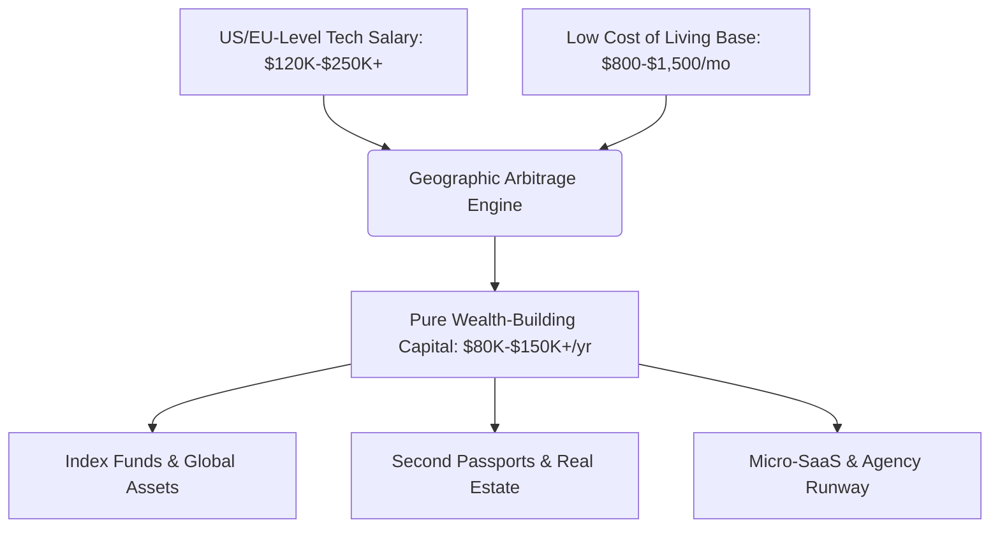

# 🌍 Comprehensive AI & Data Science Digital Nomad Playbook (2026)
## A Step-by-Step Chronological Guide & Master Hierarchical Plan

> **Scope:** This document is the ultimate, all-inclusive compilation of the four-part *AI & Data Science Digital Nomad Series*. Rather than a simple collection of documents, this playbook is structured as a chronological, step-by-step master plan. It weaves all technical skills, remote work strategies, banking architectures, travel hacks, legal compliances, cybersecurity standards, ethical guidelines, and psychological realities directly into the 5 phases of a nomad's career lifecycle. Every single detail, data point, table, checklist, and analysis from the original series has been preserved in full.
> 
> **Data Sources:** Sourced from official university pages, Henley Passport Index 2026, OECD compliance guidelines (November 2025 updates), International Bar Association's 2026 Digital Nomad Report, and verified salary and platform aggregates (2025–2026 cycles).

---

## TABLE OF CONTENTS

- [1. EXECUTIVE OVERVIEW: THE arbitrage opportunity](#1-executive-overview-the-arbitrage-opportunity)
- [2. PHASE 1: LEARN & BUILD (MONTHS 1–6)](#2-phase-1-learn--build-months-16)
  - [2.1 The Core Technical Stack](#21-the-core-technical-stack)
  - [2.2 High-Demand Niche Specializations](#22-high-demand-niche-specializations)
  - [2.3 Soft Skills for Remote Success](#23-soft-skills-for-remote-success)
  - [2.4 Free & Low-Cost Learning Resources](#24-free--low-cost-learning-resources)
  - [2.5 Portfolio and GitHub Development](#25-portfolio-and-github-development)
  - [2.6 Initial Productivity OS & Environmental Hacking](#26-initial-productivity-os--environmental-hacking)
- [3. PHASE 2: EARN & SECURE (MONTHS 6–12)](#3-phase-2-earn--secure-months-612)
  - [3.1 Remote Job Acquisition Systems](#31-remote-job-acquisition-systems)
  - [3.2 Freelancing Strategy & Productized Services](#32-freelancing-strategy--productized-services)
  - [3.3 Underrated Freelance Platforms](#33-underrated-freelance-platforms)
  - [3.4 Digital Product Marketplaces](#34-digital-product-marketplaces)
  - [3.5 Passive Income & Content Monetization](#35-passive-income--content-monetization)
  - [3.6 Initial Banking & Money Setup](#36-initial-banking--money-setup)
  - [3.7 Cybersecurity & Device Safety Protocols](#37-cybersecurity--device-safety-protocols)
- [4. PHASE 3: TRANSITION & TRAVEL (MONTHS 12–24)](#4-phase-3-transition--travel-months-1224)
  - [4.1 Top 15 Nomad Countries & Budgets](#41-top-15-nomad-countries--budgets)
  - [4.2 Visa & Passport Strategies](#42-visa--passport-strategies)
  - [4.3 Flight & Long-Stay Accommodation Hacking](#43-flight--long-stay-accommodation-hacking)
  - [4.4 Travel Hacking: Points & Miles Stack](#44-travel-hacking-points--miles-stack)
  - [4.5 Healthcare & Medical Tourism Strategy](#45-healthcare--medical-tourism-strategy)
  - [4.6 Psychological Health & Burnout Prevention](#46-psychological-health--burnout-prevention)
  - [4.7 Dating, Relationships & Social Integration](#47-dating-relationships--social-integration)
  - [4.8 Family Nomading & Worldschooling](#48-family-nomading--worldschooling)
  - [4.9 Ethical Nomadism & Gentrification Mitigation](#49-ethical-nomadism--gentrification-mitigation)
- [5. PHASE 4: SCALE & AUTOMATE (YEARS 2–5)](#5-phase-4-scale--automate-years-25)
  - [5.1 Productized Consulting & Agency Scaling](#51-productized-consulting--agency-scaling)
  - [5.2 Solo AI Micro-SaaS Development](#52-solo-ai-micro-saas-development)
  - [5.3 Earning Infrastructure & Automation Stack](#53-earning-infrastructure--automation-stack)
  - [5.4 Advanced Visa Mechanics & EOR Compliance](#54-advanced-visa-mechanics--eor-compliance)
  - [5.5 Advanced Tax Optimization](#55-advanced-tax-optimization)
  - [5.6 Advanced Currency Exchange Strategy](#56-advanced-currency-exchange-strategy)
- [6. PHASE 5: SUSTAIN, DIVERSIFY & EXIT (YEARS 5–10)](#6-phase-5-sustain-diversify--exit-years-510)
  - [6.1 Long-Term Wealth Building Stack](#61-long-term-wealth-building-stack)
  - [6.2 Second Passport & CBI Programs](#62-second-passport--cbi-programs)
  - [6.3 Natural Citizenship Pathways](#63-natural-citizenship-pathways)
  - [6.4 Mobility Gap Strategy & Passport Power](#64-mobility-gap-strategy--passport-power)
  - [6.5 Identity, Purpose & the Exit Question](#65-identity-purpose--the-exit-question)
  - [6.6 Hidden Compliance Risks & Policy Gaps](#66-hidden-compliance-risks--policy-gaps)
- [7. UNIFIED MASTER DIRECTORY OF TOOLS & RESOURCES](#7-unified-master-directory-of-tools-call-resources)

---

## 1. EXECUTIVE OVERVIEW: THE ARBITRAGE OPPORTUNITY

The intersection of Artificial Intelligence, Data Science, and location-independent work represents the single most powerful career combination of the late 2020s. 

Data scientists yield the highest average annual earnings for digital nomads at approximately **$132,000**, with remote AI/ML roles being explicitly recession-resistant due to the high cognitive complexity of the field. 

The core of this lifestyle is **Geographic Salary Arbitrage**: earning a US/EU-level tech salary ($120,000–$250,000+) while living in low-cost countries (such as Georgia, Thailand, or Colombia) where monthly expenses range between $800 and $1,500. The difference—$80,000 to $150,000+ per year—becomes pure investment capital to accelerate long-term wealth building.



### Salary Reality (2026 data):

| Role | Annual Salary Range | Remote Availability |
|---|---|---|
| Machine Learning Engineer | $127,000 – $265,000 | Very High |
| Senior Data Scientist | $120,000 – $200,000 | Very High |
| AI/ML Architect | $150,000 – $250,000+ | High |
| Data Engineer | $115,000 – $180,000 | Very High |
| Prompt Engineer | $80,000 – $160,000 | Very High |
| LLM Research Engineer | $130,000 – $220,000 | High |
| AI Consultant (freelance) | $100 – $300/hr | Very High |

---

## 2. PHASE 1: LEARN & BUILD (MONTHS 1–6)
*Goal: Build a fundable, employable technical foundation and establish baseline productivity systems.*

### 2.1 The Core Technical Stack
You must build your technical competencies in a structured, progressive sequence. Avoid jumping straight into deep learning without solid statistical foundations.

```
+--------------------------------------------------------------+
| TIER 1: Foundations (Months 1-2)                             |
| Python (NumPy, Pandas, Scikit-learn) · SQL · Statistics · Git|
+--------------------------------------------------------------+
                               |
                               v
+--------------------------------------------------------------+
| TIER 2: Machine Learning (Months 3-4)                        |
| Scikit-learn · XGBoost · Feature Engineering · MLflow        |
+--------------------------------------------------------------+
                               |
                               v
+--------------------------------------------------------------+
| TIER 3: Deep Learning & AI (Months 4-5)                      |
| PyTorch · NLP · LLMs (RAG, Fine-tuning) · GenAI APIs         |
+--------------------------------------------------------------+
                               |
                               v
+--------------------------------------------------------------+
| TIER 4: Production & MLOps (Months 5-6)                      |
| Docker · FastAPI · Cloud (AWS/GCP) · Vector DBs · LangChain  |
+--------------------------------------------------------------+
```

1. **Tier 1 — Foundation (Months 1–2):** 
   - **Python**: Master pandas, numpy, and basic algorithmic logic.
   - **SQL**: Focus on window functions, complex joins, and database optimization.
   - **Statistics & Probability**: Understand hypothesis testing, regression analysis, distributions, and Bayes' theorem.
   - **Git & Version Control**: Learn standard feature-branch workflows, rebasing, and GitHub actions.
   - **Linux & Command Line**: Comfort with SSH, bash scripting, cron jobs, and directory management.
2. **Tier 2 — Machine Learning (Months 3–4):**
   - **Algorithms**: Regression, classification, clustering, random forests, and gradient boosting (XGBoost, LightGBM).
   - **Execution**: Feature engineering, model evaluation metrics (ROC-AUC, F1, LogLoss), and validation strategies (K-Fold cross-validation).
   - **Tracking**: Experiment logging using MLflow or Weights & Biases.
3. **Tier 3 — Deep Learning & AI (Months 4–5):**
   - **Neural Networks**: Feedforward, CNNs, RNNs, and Transformers implemented in PyTorch.
   - **Natural Language Processing (NLP)**: Tokenization, embeddings, and attention mechanisms.
   - **Large Language Models (LLMs)**: API orchestration, retrieval-augmented generation (RAG), vector embeddings, and parameter-efficient fine-tuning (LoRA, QLoRA).
4. **Tier 4 — Production & MLOps (Months 5–6):**
   - **Deployment**: Packaging models in Docker containers, building APIs with FastAPI, and setting up Kubernetes.
   - **Cloud Infrastructure**: Training and deploying models on AWS SageMaker, GCP Vertex AI, or Azure ML.
   - **Vector Databases**: Pinecone, Weaviate, ChromaDB, and Qdrant.
   - **LLM Orchestration**: LangChain, LlamaIndex, and crewAI.

---

### 2.2 High-Demand Niche Specializations
Select 1 or 2 high-demand niches to distinguish yourself from generalist data scientists:

| Niche | Why It Pays | Freelance Rate |
|---|---|---|
| **AI Automation** | Small-to-medium businesses (SMBs) will pay premium rates to automate manual processes using low-code tools (Make.com, Zapier) and LLM APIs. | $50–$150/hr |
| **LLM/RAG Systems** | High enterprise demand for secure, internal knowledge base search tools with low hallucination rates. | $100–$250/hr |
| **Computer Vision** | Deep demand in manufacturing (visual inspection), security, medical imaging, and logistics. | $100–$200/hr |
| **Data Strategy Consulting**| Helping executives map data assets and build high-leverage AI roadmaps. High strategic value. | $150–$300/hr |
| **Prompt Engineering** | Bridging the gap between domain experts and raw LLM model parameters for workflows. | $75–$175/hr |
| **MLOps / AI Infrastructure**| Building robust pipelines, CI/CD, monitoring, and scaling model inference. High barrier to entry. | $130–$270/hr |

---

### 2.3 Soft Skills for Remote Success
Technical skill is only 50% of the nomad equation. The rest depends on your ability to work independently across borders:
- **Async Communication**: Default to clear, written updates (Notion docs, Linear tickets) and quick Loom videos rather than calendar meetings.
- **Output Accountability**: Consistently deliver projects on or before deadlines without prompting.
- **Data Storytelling**: Translate complex model metrics into business values (e.g., "This model reduces customer churn by 12%, which equates to $140,000 in saved monthly recurring revenue").
- **Time Management**: Self-regulate working hours in distraction-heavy environments.

---

### 2.4 Free & Low-Cost Learning Resources

| Resource | Focus Area | Cost |
|---|---|---|
| **fast.ai** | Practical, top-down deep learning and neural networks. | Free |
| **Kaggle Learn** | Micro-courses on Python, SQL, ML, and feature engineering. | Free |
| **Google Data Analytics Cert** | Foundational data cleaning, SQL, and Tableau. | ~$200 |
| **DeepLearning.AI** | LLMs, MLOps, AI agent architectures, and fine-tuning. | ~$50/mo |
| **Hugging Face Course** | Transformers, tokenizers, and dataset manipulation. | Free |
| **CS50P (Harvard)** | Rigorous introduction to Python programming. | Free |
| **Andrej Karpathy YouTube** | Neural networks from scratch (micrograd, GPT builds). | Free |

---

### 2.5 Portfolio and GitHub Development
To land remote roles or clients, you must bypass the traditional resume screen. Your GitHub repository is your primary trust asset.

#### Portfolio Checklist:
*   [ ] **Solve Real Business Problems**: Do not build generic Titanic or Iris dataset classifiers. Instead, build projects like "An End-to-End Enterprise RAG Pipeline for PDF Compliance Audits" or "Time-Series Demand Forecasting for E-commerce Inventory Management."
*   [ ] **Include a Complete Data Pipeline**: Your project must ingest raw data, perform data cleaning/transformation, run model inference, and output structured results.
*   [ ] **Write Comprehensive Documentation**: Every repository needs a `README.md` containing: a system architecture diagram, instructions for local reproduction via Docker, performance evaluation charts, and a summary of business outcomes.
*   [ ] **Deploy a Working Demo**: Host a lightweight web interface (Streamlit, Gradio, or a Next.js app) on a platform like Hugging Face Spaces, Render, or Railway so non-technical recruiters can test it instantly.
*   [ ] **Write Clean, Modular Code**: Organize your files logically (e.g., `src/data/`, `src/models/`, `configs/`, `tests/`), follow PEP 8 standards, and write basic unit tests using `pytest`.

---

### 2.6 Initial Productivity OS & Environmental Hacking
Nomad productivity relies on building a portable daily structure that produces consistent output regardless of external instability.

> [!TIP]
> **The 4-Block Daily System:**
> Divide your day into four blocks to ensure consistent focus:
> 1. **Deep Work Block (90–180 min)**: Zero notifications, phone away, focused solely on coding or model design. This is your core value-generating time.
> 2. **Communication Block (60–90 min)**: Reviewing email, updating Slack/Discord, and providing status updates.
> 3. **Admin & Logistics Block (30–60 min)**: Planning trips, invoicing clients, and reading documentation.
> 4. **Exploration & Rest Block**: Exploring the destination, exercising, and resting.

#### Environmental Hacking Protocols:
- **Consistent Auditory Anchor**: Use the exact same instrumental playlist (e.g., Lofi, synthwave, or brown noise) during every deep work session. Your brain will associate the music with immediate focus.
- **Unified Workspace Layout**: Sync your VS Code settings, shell aliases, keyboard shortcuts, and desktop wallpaper across all devices. Replicating your environment keeps your cognitive defaults constant.
- **Physical Anchor Object**: Keep a small, lightweight physical object (a specific notebook, a coaster, or a pen) on your desk during work hours. Set it up in every café or coworking space to signal to your nervous system that it is time to work.

---

## 3. PHASE 2: EARN & SECURE (MONTHS 6–12)
*Goal: Secure high-income remote employment or consistent freelance pipelines, establish legal banking, and enforce strict cybersecurity baselines.*

### 3.1 Remote Job Acquisition Systems
Remote tech recruiting relies heavily on bypassing Applicant Tracking Systems (ATS) and building professional relationships.

```
+-----------------------------------------------------------+
| Optimize Resume: ATS Keyword Matching                     |
| (Align skills precisely: PyTorch, SQL, Docker, RAG)       |
+-----------------------------------------------------------+
                              |
                              v
+-----------------------------------------------------------+
| Establish Job Pipeline: Target Specialized Job Boards     |
| (Working Nomads, Himalayas, Otta, Wellfound)              |
+-----------------------------------------------------------+
                              |
                              v
+-----------------------------------------------------------+
| Build Professional Authority: Organic Content Generation  |
| (1-3-1 System: LinkedIn + Github + Niche Substack)        |
+-----------------------------------------------------------+
```

- **ATS Optimization**: Match the exact vocabulary in target job descriptions. If a role asks for "parameter-efficient fine-tuning" and "LLM inference optimization," use those exact terms. Avoid stylized, multi-column resume PDFs; use single-column, clean text files that parsers read easily.
- **Otta & Wellfound Platforms**: These platforms specialize in startup and modern tech companies where remote flexibility is a default culture. Avoid cold-applying on massive aggregate boards (like indeed or ZipRecruiter).
- **Time Zone Flexibility positioning**: Explicitly note in your profile and cover letters: "Willing to align core working hours to match EST/GMT and operate async-first."

---

### 3.2 Freelancing Strategy & Productized Services
If you choose freelancing over employment, package your skills as fixed-scope offerings (productized services) rather than billing by the hour. Productized services decouple your earning potential from your time, eliminate scope creep, and are easier to sell to non-technical business owners.

#### Productized Service Design:

*   **The AI Readiness Audit ($3,000 – $8,000 flat):**
    *   *Timeline*: 1 week.
    *   *Deliverables*: Technical analysis of the company's data infrastructure, identifying high-ROI workflows suitable for AI automation, and a step-by-step model implementation plan.
*   **The Custom RAG System Build ($5,000 – $15,000 flat):**
    *   *Timeline*: 3–4 weeks.
    *   *Deliverables*: A deployed vector database loaded with the client’s internal PDF/docs directory, an LLM API integration with guardrails, and a secure internal user dashboard.
*   **The ML Model Sprint ($4,000 – $10,000 flat):**
    *   *Timeline*: 3 weeks.
    *   *Deliverables*: An end-to-end predictive model (e.g. churn prediction or inventory demand forecasting) packaged in a Docker container, accompanied by a performance analysis dashboard.
*   **AI Automation Workflow Build ($1,500 – $5,000 flat):**
    *   *Timeline*: 1–2 weeks.
    *   *Deliverables*: Custom low-code automations linking CRM, email platforms, and internal databases via Make.com or Zapier with integrated LLM APIs for automated processing.

---

### 3.3 Underrated Freelance Platforms
Do not limit your search to Upwork and Fiverr, where bidding wars drive rates down. Leverage these alternative marketplaces:

- **Contra**: Zero freelancer commission fees. Contra bills the client directly for platform upkeep. Clean, portfolio-first profiles, Tech-heavy client base, and instant payouts via Wise.
- **Jobbers**: 0% freelancer fee platform designed specifically for software developers and data scientists.
- **Kolabtree**: Specialized scientific and research freelancing. Highly lucrative for data scientists with academic backgrounds. Rates range from $80 to $250/hr with minimal competition.
- **Expert360**: Focuses on the Australian and New Zealand corporate consulting market. Underused by global nomads, it connects specialists to corporate clients at premium rates ($150–$400/hr).
- **Codeable**: WordPress-focused but premium-vetted. Essential if you build AI plugins, custom integrations, or database systems for enterprise WordPress setups. Average developer rate is $80–$120/hr.
- **LinkedIn Services**: Activate this module on your profile. A fully optimized profile containing niche keywords acts as a passive inbound pipeline for consulting work, carrying a 0% platform fee.

---

### 3.4 Digital Product Marketplaces
Build passive income assets by listing digital products on specialized digital platforms:

| Platform | Fee Structure | Best Suited For | Key Advantages |
|---|---|---|---|
| **Gumroad** | 10% flat fee + processing | Templates, e-books, code assets, datasets | Instant setup, clean payment links, built-in audience discoverability. |
| **Payhip** | 0% (with 5% transaction fee) to $99/mo | E-books, templates, online courses | Strong Gumroad alternative, customizable storefronts. |
| **Lemon Squeezy** | Variable | SaaS licenses, software subscriptions | Acts as a **Merchant of Record (MoR)**, handling global VAT/sales tax compliance automatically. |
| **Whop** | Pay-as-you-go | Access memberships, Discord communities, courses | Best for building recurring membership programs. |
| **Etsy** | Listing fees + ~6.5% transaction | Notion templates, content plans, guides | Access to 90 million active buyers looking for productivity tools. |
| **Creative Market** | Up to 40% commission | UI kits, icon packs, graphic design assets | Premium pricing with high-intent professional design buyers. |
| **Amazon KDP** | 30% to 70% royalties | Niche career guides, technical e-books | Global distribution, Kindle Unlimited integration. |
| **PromptBase** | ~20% flat commission | ChatGPT, Midjourney, Claude prompt packs | Low effort to create, volume-based marketplace. |

---

### 3.5 Passive Income & Content Monetization
Use your technical learning to feed a content flywheel that generates passive revenue:
- **YouTube AI Tutorials**: E-learning monetization ($2–$5 RPM via AdSense, scaling to $500–$5,000/sponsorship at 10K+ subscribers).
- **Substack/Newsletter**: Charge $5–$15/month for deep technical research. 1,000 paid subscribers can generate $5,000–$15,000/month.
- **AI-Automated Content Systems**: Use Make.com, local LLM scripts, and SEO analysis to build niche media sites. Monetize through premium programmatic ad networks (Mediavine, Ezoic).

---

### 3.6 Initial Banking & Money Setup
Before leaving your home country, establish a robust multi-layered international banking architecture.

```
                  +-----------------------------------+
                  |      Layer 1: Daily Operations    |
                  |  Wise (Multi-currency, low FX)    |
                  |  Revolut (Spend limits, insurance)|
                  +-----------------------------------+
                                    |
                                    v
                  +-----------------------------------+
                  |      Layer 2: ATM cash access     |
                  |  Charles Schwab (Refunds global fee) |
                  |  N26 (EU-equivalent fallback)     |
                  +-----------------------------------+
                                    |
                                    v
                  +-----------------------------------+
                  |      Layer 3: Client Payments     |
                  |  Payoneer (Marketplace intake)    |
                  |  Airwallex (Enterprise business)  |
                  |  Mercury Bank (US LLC Setup)      |
                  +-----------------------------------+
```

#### Layer 1 — Daily Operations (Wise & Revolut):
- **Wise**: Hold 40+ currencies with local routing/IBAN details. Best for cross-border conversion at true mid-market rates (0.33–1.5% fee).
- **Revolut**: weekday FX fees are near 0%. Use the Metal/Premium tier to access built-in travel insurance, eSIM data packages, and airport lounges.

#### Layer 2 — Global ATM Access (Charles Schwab & N26):
- **Charles Schwab (Checking)**: The single most important financial tool. Schwab **refunds 100% of global ATM fees** at the end of each month, has zero foreign transaction fees, and charges no monthly maintenance fees.
- **N26**: European operational equivalent with low cross-border fees.

#### Layer 3 — Business & Client Intake (Payoneer, Airwallex, Stripe, Mercury):
- **Payoneer**: Standard integration for Upwork, Fiverr, and global marketplaces.
- **Airwallex**: Excellent multi-currency business banking with API integration.
- **Mercury Bank**: Essential for opening US business checking accounts for Delaware/Wyoming LLCs without physical presence. Reinvestment and wire fees are zero.

---

### 3.7 Cybersecurity & Device Safety Protocols
As a remote AI professional handling proprietary algorithms and customer datasets, a security breach is a business-ending event.

> [!WARNING]
> **The Public WiFi Threat Vector:**
> Public networks (hotels, airports, cafés) are highly vulnerable to Man-in-the-Middle (MitM) attacks, packet sniffing, and "evil twin" network spoofing. Remote tech infrastructure is a primary target.

#### Non-Negotiable Security Stack:

| Component | Tool Recommendation | Purpose |
|---|---|---|
| **VPN** | Mullvad VPN, ProtonVPN | Strict no-logs policy, anonymous account creation, full encryption. |
| **Password Manager** | 1Password, Bitwarden | Enforce unique, 20+ character passwords for all systems. |
| **Hardware 2FA Key** | YubiKey 5 NFC / 5C | Phishing-proof multi-factor authentication. |
| **Full Disk Encryption** | FileVault (macOS), BitLocker (Windows)| Encrypt SSD so data is unreadable if the physical laptop is stolen. |
| **Encrypted Backups** | Backblaze, Arq Backup | Automated cloud backups running continuously in the background. |

#### Operational Security Guidelines:
1.  **Hotspot Default**: Always use your phone's cellular hotspot (with local SIM/eSIM) for banking, database access, and deploying code. Never use public WiFi for sensitive operations.
2.  **Privacy Screen Filter**: Install a physical polarized privacy screen protector on your laptop to block visual hacking (shoulder-surfing) in cafés or airports.
3.  **Physical Anti-Theft**: Use a Kensington steel cable lock to secure your laptop if working in coworking spaces. Never leave your hardware unattended.
4.  **Registry Lock**: Lock your primary domain name registrar with hardware 2FA and registry lock to prevent domain hijacking.

---

## 4. PHASE 3: TRANSITION & TRAVEL (MONTHS 12–24)
*Goal: Exit your home country, establish global visa residency anchors, master travel hacking, and manage physical and psychological wellness on the road.*

### 4.1 Top 15 Nomad Countries & Budgets
When selecting destinations, optimize for internet speeds, cost of living, visa ease, and local safety.

#### Tier 1 — Best Overall:
- **Portugal 🇵🇹**: The D8 Nomad Visa has clear paths to residency. Cost of living is $1,500–$2,500/month. Vibrant tech ecosystems in Lisbon, Porto, and Madeira. English is widely spoken.
- **Spain 🇪🇸**: Very fast nomad visa processing (~10 days). Beckham Law provides a 15% flat tax rate on income for the first 4 years. Valencia and Barcelona are world-class cities.
- **Thailand 🇹🇭**: The Destination Thailand Visa (DTV) allows 6-month stays over a 5-year period. Cost of living is $800–$1,500/month. Fast 5G connectivity.
- **Georgia 🇬🇪**: Visa-free entry for 365 days for most passports (including India). 0% tax on foreign-sourced income. Low cost of living ($700–$1,200/month in Tbilisi).

#### Tier 2 — High Quality of Life:
- **UAE 🇦🇪**: Remote Work and 10-year Golden Visas. Personal income tax is 0%. Superb infrastructure, but high cost of living ($2,500–$5,000/month).
- **Estonia 🇪🇪**: Digital nomad visa pioneer with full digital e-Residency infrastructure. Cost is $1,500–$2,500/month.
- **Croatia 🇭🇷**: 12-month nomad visa with local income tax exemptions. Cost of living is $1,200–$2,000/month.
- **Indonesia (Bali) 🇮🇩**: Canggu and Ubud have unparalleled expat density. Cost is $800–$1,500/month. 

#### Tier 3 — Budget Champions:
- **Vietnam 🇻🇳**: Cost is $700–$1,200/month (Da Nang, Ho Chi Minh). Incredible food and strong internet, but visas require periodic 90-day e-visa renewals.
- **Colombia 🇨🇴**: Nomad visa available. Cost of living is $800–$1,500/month in Medellín. Perfect US timezone overlap.
- **Mexico 🇲🇽**: Temporary residency visa is easy to secure. Cost is $800–$1,500/month (Mérida, Oaxaca, CDMX).
- **Albania 🇦🇱**: 10-year tax holiday for remote workers on foreign income. Cost is $600–$1,000/month in Tirana.

---

### 4.2 Visa & Passport Strategies
Operating legally requires a structured approach to immigration rather than working under the radar.

```
       +-------------------------------------------------------+
       |                  THE SHENGEN 90/180 ROTATION          |
       |  Spend 90 days in EU Schengen Zone (Spain, Portugal)  |
       +-------------------------------------------------------+
                                   |
                                   v
       +-------------------------------------------------------+
       |                  NON-SCHENGEN RETREAT                 |
       |  Exit to Georgia, Turkey, UK, or Balkans for 90 days   |
       +-------------------------------------------------------+
                                   |
                                   v
       +-------------------------------------------------------+
       |                  RETURN TO SCHENGEN                   |
       |  Re-enter Schengen for a fresh 90-day window           |
       +-------------------------------------------------------+
```

- **Schengen 90/180 Rule**: Non-EU citizens can only stay in the Schengen zone for 90 days in any rolling 180-day period. Rotate: spend 90 days in Western Europe (e.g. Spain/Italy), then exit to non-Schengen destinations (Georgia, UK, Montenegro, Turkey) for the next 90 days.
- **The Southeast Asia Visa Circuit**: Stacking Thailand (6-month DTV) → Vietnam (90-day e-visa) → Indonesia (60-day extendable) → Malaysia (90-day visa-free) to stay in the region indefinitely.
- **Indian Passport Optimization**: 
  - **Georgia**: Visa-free for 365 days. Useful fallback base.
  - **Thailand**: Favorable e-visas and DTV options.
  - **Portugal D8 Visa**: The ultimate Schengen access key. Requires proof of monthly income (~€3,040).
  - **Trust-Signal Visas**: Apply for US B1/B2, UK Standard Visitor, and Japanese visas. Having these stamps in an Indian passport makes subsequent global visas significantly easier to obtain.

---

### 4.3 Flight & Long-Stay Accommodation Hacking
- **Google Flights Everywhere**: Search from your hub to "Everywhere" to identify cheap routing. Apply the "positioning flights" tactic: book a cheap budget flight to a major hub (e.g. London or Singapore), then book your long-haul flight from there.
- **Avoid the Airbnb Premium**: Do not rent monthly on Airbnb; you will pay a 30–60% premium. Instead, rent a hotel room for 2 days on arrival. Use local Facebook housing groups (e.g. "Tbilisi Apartments for Rent" or "Medellín Roommates & Housing") or local classified sites to lease directly from local owners.

---

### 4.4 Travel Hacking: Points & Miles Stack
Transferring credit card points to airline partners for business class flights maximizes point value to 2–5 cents per point (compared to 1 cent cash back).

#### Point Currencies and Sweet Spots:

| Currency | Top Transfer Partners | Best Redemption Target |
|---|---|---|
| **Chase Ultimate Rewards** | United, Singapore Airlines, Hyatt | Hyatt luxury hotel stays; business class flights to Europe via Air France/KLM. |
| **Amex Membership Rewards**| Delta, Singapore, British Airways, ANA | ANA business class round-trips; Singapore Airlines Suites redemptions. |
| **Capital One Miles** | Turkish Airlines, Avianca, Air Canada | Long-haul business class flights via Avianca LifeMiles partner routes. |

#### Credit Card Foundation (US Citizens):
- **Chase Sapphire Preferred ($95/yr)**: 3x on dining, 2x on travel, 75K sign-up bonus. Essential points hub.
- **Amex Platinum ($695/yr)**: 5x on flights, Centurion lounge access, priority pass, and matching hotel statuses (Marriott/Hilton Gold). Stacking credits offset the fee.
- **Capital One Venture X ($395/yr)**: 2x flat on all purchases, lounge access, and a $300 annual travel portal credit.

---

### 4.5 Healthcare & Medical Tourism Strategy
Do not rely on standard travel insurance for long-term travel. Expat plans provide comprehensive routine and specialist coverage, whereas travel medical insurance only covers sudden emergencies.

> [!CAUTION]
> **The Insurance Gap:**
> Standard travel insurance typically expires after 90 days. Attempting to claim after being out of your home country past the policy window will result in immediate rejection.

#### Healthcare Coverage Tiers:
1.  **SafetyWing Nomad Insurance ($48–$180/mo)**: Budget-friendly emergency medical cover. Covers up to $250,000 for unexpected illnesses and accidents.
2.  **Cigna Global ($200–$500+/mo)**: Full private healthcare coverage. Access to 1.65 million clinics worldwide, covering routine dental, mental health, and preventative care.

#### Medical Tourism Arbitrage Examples:
- **Dental Implant**: $700–$1,200 in Colombia vs $4,000–$6,000 in the US.
- **Full Health Screening & Bloodwork**: $80–$200 in Bangkok (Bangkok Hospital) vs $1,000+ in the US/UK.
- **LASIK Eye Surgery**: $800–$1,500 total in Thailand vs $4,000+ in the US.

---

### 4.6 Psychological Health & Burnout Prevention
Expats are **2.5 times more likely** to experience anxiety or depression than home-country residents, primarily due to transience and loneliness.

#### Mental Health Protocols:
- **The 3-Month Rule**: Limit moves to a minimum of 3 months per destination. Research shows it takes 90 days to transition from disorientation to comfort. Frequent moves lead to chronic decision fatigue.
- **Cross-Border Telehealth**: Retain a licensed therapist via platforms like BetterHelp, Talkspace, or Headway. Confirm your therapist can legally provide care to your current country.
- **Separation of Work Contexts**: Avoid working in your bedroom. Rent a dedicated desk at a coworking space (WeWork, Selina, Outsite) to physically separate your work life from your personal life.

---

### 4.7 Dating, Relationships & Social Integration
- **Dating Transience**: Build dating expectations around the visa timelines of both parties. Use Bumble or Hinge in nomad hubs (Medellín, Lisbon, Chiang Mai) where the nomad filter is common.
- **Social Infrastructure**: Secure immediate community access by joining CrossFit/running clubs, attending local language exchanges (Meetup.com), and participating in coworking weekly community lunches.

---

### 4.8 Family Nomading & Worldschooling
- **Worldschooling**: Structured curriculum combined with hands-on learning at historical sites, museums, and natural reserves.
- **Accredited Distance Education**: Use platforms like Bridgeway Academy, Acton Academy, or Connections Academy to ensure your children's schooling is recognized globally.
- **Age Stability Windows**: Children under 10 adapt quickly to travel. Ages 10–14 need peer-group stability; slow travel to 1 move per year. Ages 14–18 should be given an active choice in the lifestyle.

---

### 4.9 Ethical Nomadism & Gentrification Mitigation
High-earning nomads spending foreign currency in lower-income countries can drive local cost-of-living increases and displace local families.

> [!IMPORTANT]
> **Ethical Spending Principles:**
> 1. Avoid renting long-term via Airbnb in historic neighborhoods (e.g. Lisbon's Alfama or CDMX's Roma Norte) to reduce housing stock pressure. Use local listing networks.
> 2. Direct your capital to the local economy: purchase groceries at local markets, eat at family-owned restaurants, and hire local specialists.
> 3. Dedicate time to learning conversational basics of the local language (e.g. Spanish, Thai, or Serbian). Showing basic linguistic respect opens social doors.

---

## 5. PHASE 4: SCALE & AUTOMATE (YEARS 2–5)
*Goal: Transition from solo freelancer to agency operator, launch automated Micro-SaaS tools, establish corporate entities, and optimize global tax exposures.*

### 5.1 Productized Consulting & Agency Scaling
To break past the $15,000/month earning ceiling, you must transition from selling your hours to managing client delivery.

```
+-----------------------------------------------------------+
| Win Consulting Client at Premium Rates ($150-$250/hr)      |
+-----------------------------------------------------------+
                              |
                              v
+-----------------------------------------------------------+
| Document Workflow with Standard Operating Procedures (SOPs)|
+-----------------------------------------------------------+
                              |
                              v
+-----------------------------------------------------------+
| Delegate Execution to Junior Sub-Contractor ($40-$80/hr)   |
+-----------------------------------------------------------+
                              |
                              v
+-----------------------------------------------------------+
| Perform QA Review & Deliver Outcome (50%-70% Profit Margin)|
+-----------------------------------------------------------+
```

1.  **Standard Operating Procedures (SOPs)**: Write detailed step-by-step instructions for data cleaning, model deployment, and dashboard maintenance.
2.  **QA Layer**: Your role shifts to managing client relationships, scoping projects, and reviewing the output of your sub-contractors before delivery.

---

### 5.2 Solo AI Micro-SaaS Development
Building highly focused software-as-a-service applications requires minimal startup capital and generates predictable monthly recurring revenue (MRR).

- **Validated Niches**:
  - Vertical-specific automated PDF data extraction engines (e.g. for real estate contracts or logistics invoices).
  - API integrations connecting legacy databases to modern LLMs with custom security policies.
- **The Solo Bootstrapper Stack**:
  - *Backend*: Python with FastAPI.
  - *Frontend*: Next.js or Bubble (no-code).
  - *Database & Auth*: Supabase or PlanetScale.
  - *Merchant of Record*: Lemon Squeezy (auto-manages global sales tax and VAT compliance).
  - *Deployment*: Railway, Fly.io, or Vercel.

---

### 5.3 Earning Infrastructure & Automation Stack
Your business infrastructure should run autonomously to ensure your income persists during travel days or timezone shifts.

#### The 1-3-1 Content Flywheel:
- **1 Long-Form Piece**: Publish one detailed technical article or YouTube video every week.
- **3 Short-Form Derivatives**: Repurpose the long-form asset into three LinkedIn posts, Twitter threads, or carousels using LLM assistants in under 30 minutes.
- **1 Newsletter**: Send a weekly email recap to your email subscriber list to pitch your consulting audits or Micro-SaaS.

#### Automated SaaS/Freelance Business Stack:

| Business Need | Tool | Automation Trigger |
|---|---|---|
| **Invoicing & Collection** | Wave, FreshBooks | Auto-creates and emails invoices; triggers follow-up payment reminders. |
| **Meeting Scheduling** | Calendly | Restricts client booking options to your exact timezone overlap windows. |
| **Client Onboarding** | Notion + Zapier | Client payment in Stripe automatically triggers creation of shared project boards. |
| **Email Nurturing** | ConvertKit | Automatically delivers welcome sequences, resources, and product pitches. |
| **Content Scheduling** | Buffer, Hypefury | Schedule weeks of content in advance to run while traveling. |

---

### 5.4 Advanced Visa Mechanics & EOR Compliance
If you are a remote employee (not a business owner), staying in foreign countries without authorization carries corporate compliance risks.

- **Permanent Establishment (PE) Risk**: Spending more than 90–180 days in a country can trigger PE rules (as updated in OECD guidelines). This grants the host nation the right to tax your employer's global profits.
- **Compliance Cases**: Companies like Netflix and Bosch have faced millions in tax penalties due to remote employees working in foreign countries without local offices.
- **EOR Solution**: Use Employer-of-Record services (Deel, Remote.com, Papaya Global, Oyster HR) to legally manage payroll, local benefits, and tax compliance in your current country of residence.

---

### 5.5 Advanced Tax Optimization
- **US Citizens (FEIE)**: The Foreign Earned Income Exclusion (FEIE) excludes up to ~$130,000 of foreign-earned income from US federal income tax. You must pass either the Physical Presence Test (330 full days outside the US in a 365-day period) or the Bona Fide Residence Test.
- **Tax Bracket Stacking**: Income above the FEIE threshold is taxed at the tax brackets that would apply if the excluded income was still taxable.
- **European Tax Breaks**:
  - *Spain (Beckham Law)*: Pay a flat 15% income tax rate for your first 4 years.
  - *Greece Nomad Visa*: 50% income tax exemption for your first 2 years of residency.
  - *Portugal NHR 2.0*: 10% flat tax rate on foreign pension and qualified income for 10 years.

---

### 5.6 Advanced Currency Exchange Strategy
Avoid the standard 1–3% spread markup charged by retail banks on foreign exchanges.

- **The DCC Trap**: Always choose to be billed in the **local currency** at ATMs and merchant terminals. Selecting your home currency allows the merchant's bank to apply Dynamic Currency Conversion (DCC), carrying a hidden 3–8% markup.
- **Voluntary Batching**: Convert currencies in large batches. Avoid exchanges during major macroeconomic reports (e.g. US Federal Reserve interest rate announcements) to avoid widened bid-ask spreads.

#### Cash vs Card Usage by Region:

| Region | Card Acceptance | Cash Strategy |
|---|---|---|
| **Western Europe** | Excellent (contactless everywhere) | Cash is rarely needed; keep €50 for emergencies. |
| **Southeast Asia** | Mixed | Cash is essential outside major cities. Withdraw cash in large batches using a fee-free ATM card. |
| **Latin America** | Variable | Cash is highly preferred. ATM withdrawal limits are low; plan withdrawals in advance. |
| **Middle East** | Excellent | Card-friendly. Apple Pay and contactless are standard in UAE. |

---

## 6. PHASE 5: SUSTAIN, DIVERSIFY & EXIT (YEARS 5–10)
*Goal: Reinvest surplus cash flow into passive assets, secure alternative citizenships, establish a permanent base-and-travel model, and mitigate long-term structural risks.*

### 6.1 Long-Term Wealth Building Stack
Reinvest the capital saved through geographic arbitrage into diversified global assets to secure financial independence.

```
+--------------------------------------------------------------+
| Liquid Assets (Wise HYS, Marcus)                             |
| Target: 6-12 Months of Expenses                              |
+--------------------------------------------------------------+
                               |
                               v
+--------------------------------------------------------------+
| Global Equities (S&P 500, All-World ETFs via IBKR)            |
| Target: Primary Compounding Engine                           |
+--------------------------------------------------------------+
                               |
                               v
+--------------------------------------------------------------+
| Diversified Assets (REITs, Remote Real Estate)                |
| Target: Cash Flow & Location Hedging                         |
+--------------------------------------------------------------+
```

- **Index Funds (Equities)**: Focus on low-cost, broad-market index funds (Vanguard S&P 500, MSCI All World) via international brokerages (Interactive Brokers).
- **Emergency Reserve**: Maintain 6 to 12 months of living expenses in cash or cash-equivalent yields (e.g. Wise interest accounts, Marcus high-yield savings) to buffer against client loss or sudden travel disruptions.

#### The $1M Nomad Wealth Accumulation Model:
*Assumptions: Starting income of $80,000, scaling to $220,000 by Year 10. Savings rate of 50–60% reinvested at a 7% average annual compound return.*

| Year | Annual Income | Savings Rate | Annual Savings | Portfolio Balance (7% Compound) |
|---|---|---|---|---|
| **1** | $80,000 | 50% | $40,000 | $42,800 |
| **2** | $100,000 | 55% | $55,000 | $103,700 |
| **3** | $130,000 | 55% | $71,500 | $183,700 |
| **5** | $180,000 | 60% | $108,000 | $420,000 |
| **7** | $200,000 | 60% | $120,000 | $740,000 |
| **10**| $220,000 | 60% | $132,000 | **$1,250,000+** |

---

### 6.2 Second Passport & Citizenship Strategy
A second passport reduces visa friction, optimizes tax options, and provides geopolitical mobility.

#### Citizenship by Investment (CBI) Options:

| Country | Minimum Investment | Processing Time | Visa-Free Access | Key Feature |
|---|---|---|---|---|
| **Dominica** | $100,000 (donation) | 2–4 months | 140+ countries | Most affordable direct passport pathway. |
| **St. Lucia**| $100,000 (donation) | 3–6 months | 140+ countries | Excellent Caribbean program. |
| **Grenada** | $150,000 (donation) | 4–6 months | 140+ countries | Only Caribbean CBI eligible for the US E-2 Investor Visa. |
| **Vanuatu** | $130,000 (donation) | 30–60 days | 96+ countries | Fastest processing time globally. |
| **St. Kitts**| $250,000 (real estate)| 2–4 months | 155+ countries | Well-established program. |

#### Residency by Investment (Golden Visas):
- **Portugal Golden Visa**: €250,000–€500,000 investment. Requires only 7 days/year physical presence; grants citizenship eligibility after 5 years.
- **Greece Golden Visa**: €250,000–€800,000 real estate purchase. Grants full EU Schengen residency access.
- **UAE Golden Visa**: 10-year residency for investments of $200,000+ or specialized high-salary tech status.

---

### 6.3 Natural Citizenship Pathways
If you prefer not to make large investments, secure citizenship through residency or ancestry:
- **Argentina**: The fastest naturalization pathway in the world. Requires **2 years of legal residency** and basic Spanish language skills. Grants visa-free access to the EU and UK.
- **Ancestry (Ireland & Italy)**: Irish citizenship by grandparent ancestry (185 visa-free destinations) and Italian citizenship (*jure sanguinis*) with no generational limit.
- **Portugal (D8 Route)**: 5 years of legal residency on a D8 Nomad Visa qualifies you to apply for Portuguese citizenship (and an EU passport).

---

### 6.4 Mobility Gap Strategy & Passport Power
PASSPORT STRENGTH IS THE FOUNDATION OF MOBILITY. According to the 2026 Henley Passport Index:
1.  **Singapore** (Rank 1: 192 visa-free destinations).
2.  **Japan & South Korea** (Rank 2: 188 visa-free destinations).
3.  **United States** (Rank 10: 179 visa-free destinations).
4.  **India** (Rank 80: 55 visa-free destinations).

#### Closing the Passport Mobility Gap (for lower-tier passports):
- Use the **Anchor Visa Strategy**: obtain a long-term residency visa (e.g. Portugal D8 or Greece Golden Visa) to gain Schengen-wide access without individual visa applications.
- Build visa credibility by applying for US B1/B2, UK, and Schengen visas in sequence. These stamps act as global trust signals.

---

### 6.5 Identity, Purpose & the Exit Question
Continuous travel can eventually lead to identity erosion—what Seneca described as "everywhere is nowhere." Fulfillment requires using freedom in service of a compounding craft or business rather than travel as an end in itself.

#### The Base-and-Travel Endgame:
The most sustainable endgame for long-term nomads is not settling down completely, but transitioning to a **Base-and-Travel Model**:
- Purchase or lease a permanent home base in a country you love that offers favorable tax rules (e.g. Spain, Georgia, Portugal, or UAE).
- Spend 6–9 months of the year at your base building local relationships, routines, and community.
- Spend 3–6 months of the year traveling internationally. This achieves **chosen stillness with deliberate adventure**.

---

### 6.6 Hidden Compliance Risks & Policy Gaps
- **The Pension Black Hole**: Nomads who do not pay social security taxes in any jurisdiction face a zero-pension retirement. You must self-fund your retirement by dedicating 15–20% of your earnings to private investment portfolios (IRAs in the US, SIPPs in the UK, or global index funds).
- **Healthcare Routine Care Gaps**: Most nomad insurance plans cover emergencies but exclude chronic illness management, local GP visits, and preventative check-ups. Long-term nomads should register with private healthcare clinics at their primary base.
- **Equity Vesting Tax Exposure**: Residing in a country under a digital nomad visa while employee stock options vest can expose those stock gains to local tax. Consult a cross-border tax specialist before relocating during an equity vesting event.
- **The 36% Consent Gap**: The International Bar Association's 2026 Digital Nomad Report notes that 36% of remote employees work across borders without formal company authorization, exposing employers to corporate tax liabilities (PE risk) and violating local immigration rules.

---

## 7. UNIFIED MASTER DIRECTORY OF TOOLS & RESOURCES

### Career & Jobs
- [Working Nomads](https://www.workingnomads.com) — Curated remote tech and data science jobs.
- [Himalayas](https://himalayas.app) — Tech-focused remote job board.
- [RemoteOK](https://remoteok.com) — Tech and developer job aggregation.
- [Wellfound](https://wellfound.com) — High-quality startup jobs.
- [Arc.dev](https://arc.dev) — Developer marketplace and remote hiring.

### Visa & Immigration
- [Nomad List](https://nomadlist.com) — Real-time cost, safety, and visa details by city.
- [iVisa](https://www.ivisa.com) — Simplified online visa applications.
- [Sherpa](https://www.visasherpa.io) — Real-time travel rules and passport requirement checkers.

### Banking & Business Entities
- [Wise](https://wise.com) — Multi-currency daily operational banking.
- [Revolut](https://revolut.com) — Cash spending, currency exchange, and travel insurance.
- [Charles Schwab](https://www.schwab.com) — Checking account with 100% global ATM fee refunds.
- [Mercury Bank](https://mercury.com) — Business banking for remote founders and US LLCs.
- [Airwallex](https://www.airwallex.com) — Business multi-currency cards and automated FX.
- [Payoneer](https://www.payoneer.com) — Receiving portal for freelance marketplaces.

### Flights & Accommodation
- [Google Flights](https://www.google.com/flights) — Flight pricing alerts.
- [Skyscanner](https://www.skyscanner.com) — Open destination search.
- [Kiwi](https://www.kiwi.com) — Multi-city booking engines.
- [Secret Flying](https://www.secretflying.com) — Mistake fares and flight deal alerts.
- [Outsite](https://www.outsite.co) — Premium co-living spaces for remote professionals.

### Tax & Compliance
- [Taxes for Expats](https://www.taxesforexpats.com) — US expat tax preparation.
- [Greenback Tax Services](https://www.greenbacktaxservices.com) — Expat tax CPA filing.
- [MyExpatTaxes](https://www.myexpattaxes.com) — Expat tax software.
- [Centuro Global](https://www.centuroglobal.com) — Corporate mobility and employment compliance.
- [Deel](https://www.deel.com) — Global payroll and EOR compliance.

### Healthcare & Wellness
- [SafetyWing](https://safetywing.com) — Nomad-specific travel medical insurance.
- [Cigna Global](https://www.cignaglobal.com) — Comprehensive international medical plans.
- [BetterHelp](https://www.betterhelp.com) — Global video telehealth therapy.

### Digital Products & SaaS
- [Gumroad](https://gumroad.com) — Simple e-commerce checkout.
- [Payhip](https://payhip.com) — Digital store builder.
- [Lemon Squeezy](https://www.lemonsqueezy.com) — Merchant of Record for SaaS sales tax compliance.
- [Whop](https://whop.com) — Creator communities and membership billing.
- [PromptBase](https://promptbase.com) — AI prompt marketplaces.

### Cybersecurity & Privacy
- [Mullvad VPN](https://mullvad.net) — Privacy-focused, no-logs VPN.
- [1Password](https://1password.com) — Enterprise password manager.
- [Yubico](https://www.yubico.com) — Hardware 2FA security keys.
- [Backblaze](https://www.backblaze.com) — Unlimited cloud backups.
- [Krisp](https://krisp.ai) — AI microphone background noise cancellation.

### Communities & Forums
- [r/digitalnomad](https://www.reddit.com/r/digitalnomad) — Expat and nomad forum.
- [MLOps Community](https://mlops.community) — MLOps Slack network.
- [Hugging Face Discord](https://discord.com/invite/huggingface) — Deep learning and open-source models.
- [Visa Journey](https://www.visajourney.com) — Community-sourced visa processing times and approval rates.

---
*Disclaimer: Compiled June 2026. Global visa regulations, tax treaties, and platform fee policies are subject to frequent change. Always consult certified financial advisors, tax attorneys, and immigration lawyers before making permanent cross-border relocations.*
